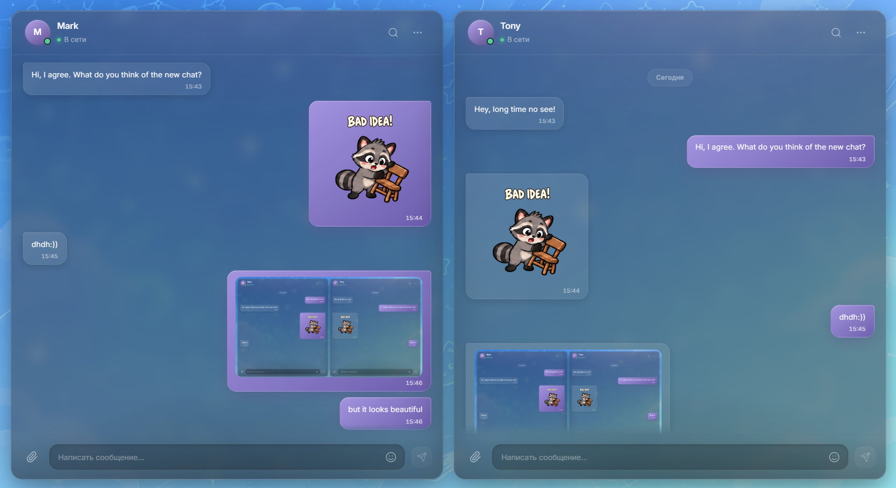

# Realtime Chat

A real-time chat application built with **React, TypeScript and Go**. Supports instant messaging, file sharing, images and cartoon stickers.

## Preview



## Tech Stack

- **Frontend:** React, TypeScript, Vite, Zustand, SCSS
- **Backend:** Go, WebSocket
- **API:** mssgs Stickers API

## Getting Started

### Requirements

- Node.js
- Go 1.25+
- Git

### 1. Clone the repository

```bash
git clone https://github.com/Maxim-Coder-arch/realtime-chat.git
cd realtime-chat
```

### 2. Start the backend

```bash
cd backend
go mod download
go run ./cmd/server
```

The backend will start at `http://localhost:8080`.

### 3. Configure the frontend

Create a `.env.local` file in the `frontend` directory:

```env
VITE_WS_URL=ws://localhost:8080/ws
VITE_API_URL=http://localhost:8080
VITE_STICKERS_API_URL=https://mssgs-stickers.com/api/v1
VITE_STICKERS_API_KEY=your_api_key
```

Get your API key from [mssgs Stickers API](https://mssgs-stickers.com/developers).

### 4. Start the frontend

Open another terminal:

```bash
cd frontend
npm install
npm run dev
```

Open `http://localhost:5173` in your browser.

---

**Note:** Run both the backend and frontend simultaneously. Messages are transmitted in real time through WebSocket connections.